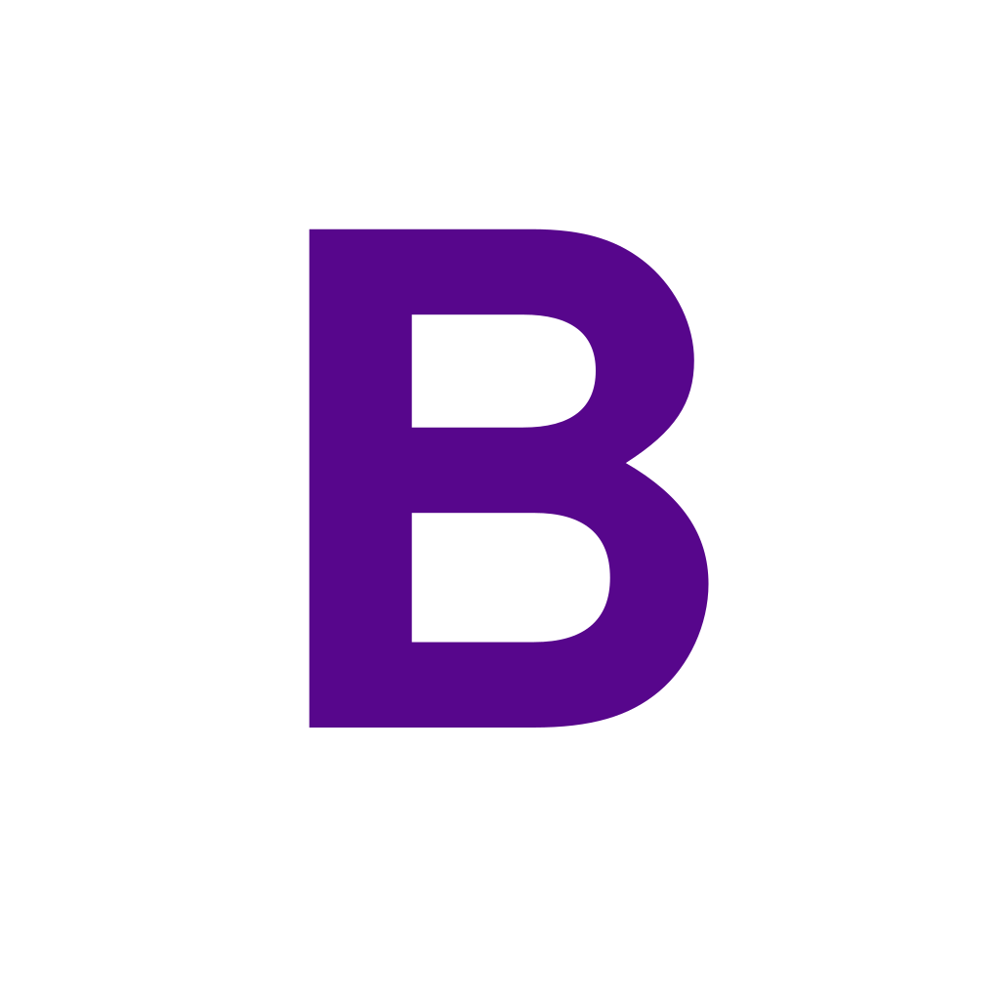

# Brightspace DDL



开源 macOS 菜单栏作业提醒工具，支持 NYU Brightspace、Gradescope、Cengage / WebAssign 和 Keenly Tasks。原生磨砂弹出面板固定在菜单栏图标下方，点击外部收起。

每小时同步 NYU Brightspace，纽约时间每天 17:00 汇总未来 7 天 DDL；唤醒后补同步和补发当天汇总。Brightspace 同步无需浏览器常驻；其他平台需 Chrome 扩展和已登录的课程标签页。无需 Codex。

独立学生项目，与 NYU、D2L 或其他平台无隶属或官方合作关系。图标为白底紫色 B，不使用学校校徽。

## 安装

需要 Apple Silicon Mac、macOS 13 或更新版本。当前构建脚本仅支持 arm64。

1. 从 [GitHub Releases](https://github.com/LynnerHuXC/Brightspace-DDL/releases) 下载 App ZIP 并解压。
2. 如需从源码构建，请安装 Xcode Command Line Tools，然后在项目目录运行 `bash build.sh`。
3. 将 `Brightspace DDL.app` 放入用户目录的 `Applications` 文件夹并打开。
4. App 1.5 起会在启动时自动配置 Chrome 连接，无需 Python，也支持系统的 `/Applications`。打开 App 设置，点击“打开扩展文件夹”，然后在 Chrome 的 `chrome://extensions` 开启开发者模式，选择“加载已解压的扩展程序”并选中这个 `Extension` 目录。
5. 刷新已登录的课程页面，点击扩展查看同步状态。

App 使用本地临时签名，尚未经过 Apple 开发者公证。请先审阅源码，或在自己的 Mac 上构建。

## 隐私与许可证

MIT 许可证，见 [LICENSE](LICENSE)。私人订阅地址只存入本机钥匙串，作业缓存只保存在本机。仓库不包含用户日历、登录 cookie、私钥或订阅 token。提交 issue 时请勿粘贴私人订阅链接、缓存或含个人信息的网页。

## 使用

安装位置：`~/Applications/Brightspace DDL.app`。点击菜单栏的日历/DDL 图标打开清单，关闭窗口后仍后台运行。设置中可以开启登录启动、授权通知、发送测试通知。

- **自动同步**：复制 Brightspace → Calendar → Subscribe 中显示的完整私人链接，粘贴到设置，点击“保存并同步”。不要把 Download 下载的文件当作订阅地址。地址保存在本机钥匙串。
- **导入文件**：“导入 .ics 文件…”可以选择下载的 `feed.ics`。这是一次性快照，支持按现有日期提醒，但不能自动获取老师之后的修改。界面会明确显示快照状态。重新保存订阅链接会恢复后台同步。
- 支持 ⌘V 粘贴、⌘A 全选和标准编辑菜单。密码样式输入框会隐藏私人订阅地址。

日历不提供提交状态；仅包含日历已发布项目，可能遗漏公告、教学大纲和外部平台作业。Special Access 个人截止时间会保留。考试及其他非 Due 事件单独展示。

电脑休眠、关机或 App 退出时无法保证准时运行；唤醒后补发的是当天汇总，不追补多天历史。系统专注模式可能隐藏通知。读取失败保留缓存并标记错误；不支持的重复事件或日期会明确报错。

## 开发与验证

需要 Swift 命令行工具、Apple Silicon Mac（macOS 13+）。无第三方依赖。

```sh
bash test.sh
bash build.sh
```

构建时先在 `/private/tmp` 生成并临时签名 `.app`，避免 iCloud/File Provider 给 app 目录加 Finder 属性导致签名失败。生成的安装压缩包位于 `dist/BrightspaceDDL.zip`，实际构建目录记录于 `.build/app-path.txt`。临时签名适合当前 Mac 本地使用，未做 App Store 发布或开发者公证。

本机数据：钥匙串服务 `local.brightspace.ddl`；缓存 `~/Library/Application Support/BrightspaceDDL/snapshot.json`；偏好设置保存登录后的提醒去重与快照模式。源码及压缩包不包含私人订阅地址。

1.1 验证：25 项检查通过（含真实 feed 核对），已实际验证下载的 `feed.ics` 导入、快照提示、输入框键盘粘贴/全选和恢复在线同步。登录启动状态与通知权限已在运行中的 App 检查。

## Gradescope 与 Cengage / WebAssign（1.2）

配套 `Extension` 文件夹是本机 Chrome 扩展。它只读取课程作业元数据（课程、名称、截止时间、明确的提交状态），通过 Chrome Native Messaging 交给 App 自带的 `DDLBridge`。不复制登录 cookie、密码、分数或答案，不上传到其他服务器。

- 首次在 Chrome 扩展管理页面开启开发者模式，加载 `Extension` 文件夹，然后刷新课程作业页面。App 1.5 会自动注册本机连接组件。
- 保留每门 Gradescope 课程的作业列表标签页，以及 WebAssign 的 Home / My Assignments 标签页。Chrome 运行并保持登录时，每小时对这些页面进行只读 GET。不会刷新用户标签页、打开提交弹窗或发送作业。
- WebAssign 首页最多只提供部分当前作业；打开 My Assignments 会捕获其完整可见列表。之后局部同步保留未再次出现的项目及其原确认时间，不把消失理解为取消或完成。页面中缺少可确定 DDL 的项目会计入警告。
- Gradescope 仅使用普通 Due Date，不使用 Released 或 Late Due Date。明确 Submitted 的项目在 App 中折叠展示并排除提醒。没有提交状态时显示截止日期，但不称其“未完成”。WebAssign 分数不用于推断提交状态。
- App 每分钟读取本机同步结果。App“刷新”读取本机结果并更新 Brightspace；Chrome 扩展的“立即同步”抓取网站。关闭标签页、Chrome 退出或登录失效时，保留旧结果；超过两小时会提示数据可能过期。
- 外部课程缓存位于 `~/Library/Application Support/BrightspaceDDL/external/`，与 Brightspace 缓存独立。只合并相同平台、课程、作业 ID 的记录，不猜测跨平台同名项目是否重复。
- 原有每天纽约时间 17:00 汇总继续使用合并后的清单。Mac 唤醒可能延迟通知。

网页解析测试：`npm ci --ignore-scripts && npm run test:extension`。原生测试：`bash test.sh`。打包：`bash build.sh`。

协议依据：[Chrome Native Messaging](https://developer.chrome.com/docs/extensions/develop/concepts/native-messaging)；调度依据：[Chrome alarms](https://developer.chrome.com/docs/extensions/reference/api/alarms)。

## Keenly Tasks（App 1.3 / Extension 1.1）

增加 `https://keenly.study/tasks`：读取已加载列表中的任务名、课程、日期和 Done/Submitted/Feedback ready 状态。只提供日期的任务显示“截止时间未注明”，不会伪造 23:59 或列入精确的 24 小时倒计时。相对日期以页面加载日的浏览器本地日期换算；月日标签缺少年份时按当前年份，Later 跨年项目按下一年。完成卡片即使不再显示日期，也能清除同 ID 已缓存提醒。消失不代表完成。

保持 Keenly Tasks 标签页及登录。每小时/扩展“立即同步”会打开临时后台 Tasks 页，读取动态加载后的列表，然后自动关闭；失败时一分钟后清理并保留旧缓存。不会打开答题或提交页面。新增的 Keenly 网站访问权限需在 Chrome 确认。

给另一台 Mac 更新时，同时传新版 `dist/BrightspaceDDL.zip` 和整个 `Extension` 目录：先替换 App，再在 Chrome 扩展管理页面重新加载扩展并确认 Keenly 权限。保留原有安装路径，原生连接配置无需重装。
